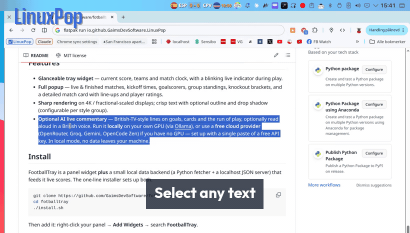

# vinoPop

> Like PopClip on the Mac, but for Linux.



Highlight some text and a little bar of buttons shows up right over it. Copy it, open it, search it, translate, summarize or rewrite it with a local model, run it as a command, encode it, do maths on it. Whatever makes sense for whatever you grabbed. You never have to move your hands away from where you were already working.

It runs on X11 (Cinnamon, GNOME-on-X11, KDE, XFCE, MATE, take your pick) and natively on KDE Plasma 6 / Wayland. Free, open source, and nothing phones home.

> **X11 desktop users:** vinoPop supports X11, but recent testing has focused on KDE Plasma 6 / Wayland. If you hit a rough spot on Cinnamon, GNOME-on-X11, XFCE, or MATE, please [open an issue](https://github.com/karanshukla/vinoPop/issues).

---

## What it does

- **Reads what you selected** and shows the buttons that fit: links, shell commands, file paths, emails, or just plain text.
- **Global hotkey** to pop the bar on your current selection from any app.
- **Tray icon** for settings, the plugin manager, and a quick on/off toggle.
- **Plugins are just `.py` files.** Drop one in `~/.config/vinopop/plugins/`, or grab one from the built-in list.
- **Plenty come bundled:** Base64, JSON pretty-print, URL encode/decode, a calculator, case conversion, slugify, QR codes, offline translate / summarize / rewrite / explain, and run-in-terminal for things that look like commands.
- **Double-click a word** (while holding a modifier) to pop the bar. Works on real Wayland, not just XWayland.
- **Your text stays on your machine** unless you click something that obviously goes online, like web search or opening a link.

---

## Install from source

### System dependencies

```sh
# Ubuntu / Linux Mint / Debian
sudo apt-get install -y python3 python3-gi python3-gi-cairo gir1.2-gtk-4.0 \
    gir1.2-adw-1 xclip xdotool xdg-utils python3-xlib

# Fedora
sudo dnf install -y python3 python3-gobject gtk4 libadwaita \
    xclip xdotool xdg-utils python3-xlib

# Arch
sudo pacman -S python python-gobject gtk4 libadwaita \
    xclip xdotool xdg-utils python-xlib
```

vinoPop uses GTK 4 (4.14 or newer) and libadwaita (1.5 or newer), so Ubuntu
24.04, Fedora 40, Debian 13 or anything newer.

For the tray icon, install PySide6 for the Python that runs vinoPop (it runs the
icon in a small Qt process so it works natively on KDE and over StatusNotifier):

```sh
sudo apt-get install -y python3-pyside6.qtwidgets   # Ubuntu / Debian
sudo dnf install -y python3-pyside6                 # Fedora
sudo pacman -S pyside6                              # Arch
# or, anywhere: pip install --user PySide6
```

Without it vinoPop runs fine but has no tray icon. Start with `--no-tray` to skip
the attempt, and open the windows directly with `python3 settings_gui.py` and
`python3 plugin_manager.py`.

Optional: `qrencode` for the QR plugin, and gtk4-layer-shell for native popup
placement on KDE Plasma / wlroots Wayland (`gir1.2-gtk4layershell-1.0` on
Debian 13 / Ubuntu 24.10+, `gtk4-layer-shell` on Fedora and Arch).

On GNOME, vinoPop runs on XWayland automatically: mutter has no layer-shell,
so a Wayland-native popup couldn't be placed at the selection. On KDE and
wlroots compositors it uses gtk4-layer-shell when it is installed, and falls
back to XWayland otherwise.

### Offline AI (OCR, summarize, rewrite, explain, translate)

These run on your own machine through OpenVINO: the LLM on an Intel NPU when
there is one, OCR on the iGPU, and the CPU otherwise. Install the Python side
for the same Python that runs vinoPop:

```sh
pip install --user -r requirements-ai.txt
```

(On Debian/Ubuntu, whose system Python refuses `pip --user`, add
`--break-system-packages` or run vinoPop from a venv created with
`--system-site-packages` so it still sees PyGObject.)

The model downloads once (Gemma 4 E2B, about 4 GB, fast and light on RAM, or
set `"ai_llm_model": "gemma-4-e4b"` for the more accurate 5 GB one). Onboarding
asks whether to get it now, in the background; otherwise the first AI action
downloads it. Settings → Advanced → *Download the AI model in the background*
changes that answer later. After that nothing goes online. `"ai_device"`
forces `"NPU"`, `"GPU"` or `"CPU"`.

`python3 main.py --doctor` (add `--json` for a bug report) checks the AI
packages, which devices OpenVINO sees and the order each model will try them
in, and whether the model is downloaded. With
[ovfetch](https://github.com/karanshukla/ovfetch) installed it also reports
whether the pinned OpenVINO is inside the range Intel records for your NPU
driver. Like vinoWhisper's doctor this is diagnosis only: the NPU is still
tried, and falls back to GPU/CPU if it won't compile.

### Install vinoPop

```sh
git clone https://github.com/karanshukla/vinoPop.git ~/vinopop
cd ~/vinopop
bash install.sh
```

`install.sh` sets up autostart and checks your dependencies. To start it right away without logging out:

```sh
python3 ~/vinopop/main.py
```

To uninstall:

```sh
bash ~/vinopop/install.sh --uninstall
```

---

## Using it

- Select text in any app and the popup appears above your selection.
- Press the hotkey (default `Super+Shift+Y`) and the popup appears at the cursor with whatever's selected.
- Hit `Esc`, click somewhere else, or just wait a few seconds and it goes away.
- The tray icon toggles auto-popup, opens Settings, and manages Plugins.

### Settings

Right-click the tray icon and pick **Settings**, or edit
`~/.config/vinopop/settings.json` by hand.

| Key | Default | Description |
|---|---|---|
| `hotkey` | `super+shift+y` | Combo to summon popup. Record via Settings dialog. |
| `hotkey_source` | `primary` | `primary` (highlighted) or `clipboard` |
| `show_on_selection` | `true` | Auto-popup when you select text |
| `auto_hide_initial_ms` | `6500` | Hide if mouse never reaches popup |
| `auto_hide_leave_ms` | `4000` | Hide this long after mouse leaves the safe zone |
| `min_selection_length_enabled` | `false` | Enable the minimum-selection-length filter |
| `min_selection_length` | `2` | When enabled, ignore selections shorter than this |
| `terminal_keep_open` | `true` | Keep terminal open after running a command |
| `double_click_popup_enabled` | `false` | Hold a modifier + double-click a word to pop the bar |
| `double_click_modifier` | `ctrl` | Modifier for the double-click trigger (`ctrl`/`alt`/`super`/`shift`) |
| `translate_target_lang` | `en` | Target language for the Translate plugin (ISO code) |
| `editable_atspi_listener_enabled` | `false` | Use AT-SPI for editable detection + selection geometry |
| `popup_anchor_to_selection` | `true` | Anchor popup to the selection rect (needs AT-SPI enabled) |

### Plugins

Open **Plugins…** from the tray menu to add or remove the built-in ones, or
drop your own `.py` file into `~/.config/vinopop/plugins/`.

A plugin file just needs a top-level `register(register_plugin)` function:

```python
from classifier import ContentType
from plugin_base import Plugin


def _handler(text: str) -> None:
    print("got:", text)


def register(register_plugin) -> None:
    register_plugin(
        Plugin(
            name="my-plugin",
            icon="emblem-favorite-symbolic",
            tooltip="Do something",
            handler=_handler,
            content_types=(ContentType.PLAIN_TEXT,),
            priority=50,
        )
    )
```

See [CONTRIBUTING.md](CONTRIBUTING.md) for the full plugin API.

---

## Known rough edges

- **X11 support has had less recent testing.** The X11 backend (Cinnamon, GNOME-on-X11, XFCE, MATE) still runs, but recent testing has focused on KDE Plasma 6 / Wayland. Please file issues if you hit a glitch.
- **Wayland support means KDE Plasma for now.** vinoPop has a real Wayland backend on KDE Plasma 6: selection through `wl-clipboard`, popup placement through `gtk4-layer-shell` (XWayland when it isn't installed), cursor position through KWin's scripting API. Other compositors (GNOME, wlroots) drop back to the X11 path under XWayland; GNOME's mutter has no layer-shell, so there it always runs on XWayland. There's more detail in [docs/FEDORA-KDE.md](docs/FEDORA-KDE.md). On KDE Wayland the global hotkey runs through KGlobalAccel (check it actually bound under System Settings, Shortcuts), Paste/Cut press keys through the desktop's Remote Control portal (KDE asks once; `ydotool` + `ydotoold` is the fallback), modifier+double-click needs your user in the `input` group, and the active-window blocklist isn't wired up yet. Popup placement, hover persistence, and click-outside dismissal all work natively. You can anchor the popup to the selected text instead of the mouse if you turn on desktop accessibility (AT-SPI).
- **HiDPI** works, but I've mostly tested it at 2× scaling. File an issue if the popup lands in the wrong spot on your setup.
- **The odd input grab.** If another app is holding an X11 input grab (an open menu, say), the popup might not catch your outside-click right away.

---

## Credits

vinoPop is a fork of [LinuxPop](https://github.com/GaimsDevSoftware/linuxpop)
by Robert Berge. Thanks for the original project!

---

## License

MIT. See [LICENSE](LICENSE).
