<p align="center"></p>

<h1 align="center">vinoPop</h1>

<p align="center">A Linux text-selection popup bar inspired by PopClip, with offline AI actions running locally on your Intel NPU.</p>

<p align="center"></p>

When you select text in any application, vinoPop shows a floating action bar above the selection. Depending on what you highlighted, you can copy it, search the web, translate, summarize, or rewrite it with a local model, run it in a terminal, encode it, or evaluate math expressions.

- **Context-aware actions.** Detects links, shell commands, file paths, email addresses, and plain text to show buttons suited to the selection.
- **Offline AI and speech.** Summarize, rewrite, explain, and translate run Gemma 4 locally via OpenVINO on an Intel NPU (falling back to GPU or CPU when no NPU is available). On a 16 TOPS NPU, Gemma 4 E2B runs at ~5.6 tokens/s and draws ~2–4 W. Press `Shift+Super+O` to run OCR on a screen region, or install **Read aloud** from the Plugin Manager to speak selected text using [vinoSpeak](https://github.com/karanshukla/vinoSpeak)'s Kokoro voice on the NPU.
- **Clipboard history and snippets.** Press `Super+Shift+V` to browse recent text and images, pin entries, and insert snippets with placeholders such as `{date}` and `{clipboard}`.
- **Plugins and no-code recipes.** Write custom plugins as standalone `.py` files, or use the built-in recipe builder to create web searches, shell commands, and text transforms without code. Built-in tools cover Base64, JSON, hashes, timestamps, colors, a calculator, case conversion, QR codes, and more.
- **Local-first privacy.** Your text stays on your machine unless you explicitly trigger an online action such as web search or opening a link. There is no telemetry or background phone-home traffic.

vinoPop runs natively on KDE Plasma 6 (Wayland) and via XWayland on GNOME, sway, Hyprland, and other Wayland desktops. Plain Xorg sessions (Cinnamon, XFCE, MATE, and similar desktops) are supported on a best-effort basis.

## Requirements

- GTK 4.14+ and libadwaita 1.5+ (Ubuntu 24.04, Fedora 40, Debian 13, or newer).
- For offline AI: an Intel NPU (Core Ultra or newer) with the [Intel Linux NPU driver](https://github.com/intel/linux-npu-driver). If no NPU is available, it runs on the iGPU or CPU at lower speed.

## Install

Install the required system packages first:

```sh
# Ubuntu / Linux Mint / Debian
sudo apt-get install -y python3 python3-gi python3-gi-cairo gir1.2-gtk-4.0 \
    gir1.2-adw-1 librsvg2-common xdg-utils python3-pyside6.qtwidgets

# Fedora
sudo dnf install -y python3 python3-gobject gtk4 libadwaita xdg-utils python3-pyside6

# Arch
sudo pacman -S python python-gobject gtk4 libadwaita xdg-utils pyside6

# openSUSE Tumbleweed
sudo zypper install python3 python3-gobject python3-gobject-Gdk typelib-1_0-Gtk-4_0 \
    typelib-1_0-Adw-1 gdk-pixbuf-loader-rsvg xdg-utils python3-pyside6
```

Then install the additional packages for your desktop environment ([details and package name differences](docs/install.md#packages-for-your-desktop)):

| Desktop | Install |
|---|---|
| GNOME, sway, Hyprland, other non-KDE Wayland desktops, and plain Xorg | `xclip python3-xlib` |
| KDE Plasma Wayland | `wl-clipboard`, plus `gtk4-layer-shell` and `ydotool` (both optional) |

Next, install vinoPop from the latest release (no `sudo` required; append `-s -- --with-ai` after `bash` to include offline AI and OCR dependencies):

```sh
curl -fsSL https://github.com/karanshukla/vinoPop/releases/latest/download/get.sh | bash
vinopop
```

`get.sh` verifies the release tarball against `SHA256SUMS`, extracts it to `~/.local/share/vinopop`, and runs `install.sh` to check dependencies, configure autostart and the app launcher, and place a `vinopop` command in `~/.local/bin`.

- **AI model:** Approximately 4 GB, downloaded once when you approve it during onboarding or when you run your first AI action. All AI inference runs locally afterward.
- **Upgrade:** Run `vinopop-upgrade`, or click **Check for updates** under Settings > Advanced (update checks only run when requested).
- **Uninstall:** Run `vinopop-upgrade --uninstall` (this also removes the downloaded AI model).

See [docs/install.md](docs/install.md) for installing from a git clone, Fedora Atomic, openSUSE Aeon and Kalpa, running without a tray icon, and what uninstall preserves.

## Usage

- **Select text** in any application to show the action bar above the selection.
- **`Super+Shift+Y`** opens the bar at the pointer for the current selection, or closes it if it is already open. On X11, you can move between buttons with the arrow keys or `Tab` and trigger one with `Enter` or `Space`.
- **`Super+Shift+V`** opens clipboard history and snippets.
- **`Shift+Super+O`** captures a screen region for OCR, useful for non-selectable text in PDF scans, video frames, or error dialogs. Drag a box with the mouse, or [control it from the keyboard](docs/install.md#ocr-from-the-keyboard).
- **Modifier + double-click** on a word also opens the bar on native Wayland as well as XWayland (disabled by default in Settings).
- Press `Esc`, click elsewhere, or wait a few seconds to dismiss the bar. Use the tray icon to toggle auto-popup or open Settings and Plugins.

Outside KDE Plasma, bind your desktop's custom keyboard shortcuts to `vinopop --trigger popup` (or `ocr`, `clipboard`, `settings`). The built-in X11 hotkeys only fire while an X11 window has focus. See [per-desktop shortcut setup](docs/install.md#hotkeys-off-kde).

<p align="center"></p>

## Settings and plugins

Right-click the tray icon and choose **Settings**, or edit `~/.config/vinopop/settings.json` directly. Every configuration key is documented in [How it works](docs/how-it-works.md#settings).

Choose **Plugins…** in the tray menu to enable or remove bundled plugins and build no-code recipes under **Custom**. Prebuilt search recipes for Wikipedia, Maps, YouTube, Stack Overflow, MDN, GitHub, PyPI, and npm are included. To write a custom Python plugin, place a `.py` file defining a `register` function in `~/.config/vinopop/plugins/`; see [CONTRIBUTING.md](CONTRIBUTING.md#writing-a-plugin) for an example and the full API.

## Known limitations

- **Plain Xorg is best-effort.** It shares the XWayland backend's code path but receives less testing. If you run into issues on Cinnamon, XFCE, or MATE, please [open an issue](https://github.com/karanshukla/vinoPop/issues).
- **Native Wayland currently targets KDE Plasma.** GNOME, sway, and Hyprland use the XWayland backend. See [Backends](docs/how-it-works.md#backends) for details.
- **HiDPI scaling** works, though it has primarily been tested at 2× scaling.
- **X11 input grabs.** If another application holds an active X11 input grab (such as an open context menu), clicking outside the popup may not dismiss it immediately.

## Documentation

- [Install notes](docs/install.md): per-desktop packages, git clone setup, immutable distros, and hotkeys outside KDE.
- [How it works](docs/how-it-works.md): desktop backends, offline AI setup, architecture notes, and every setting.
- [Fedora KDE notes](docs/FEDORA-KDE.md): KDE Plasma Wayland backend details and key injection setup.
- [CONTRIBUTING.md](CONTRIBUTING.md) and [SECURITY.md](SECURITY.md).

## Credits

vinoPop began as a fork of [LinuxPop](https://github.com/GaimsDevSoftware/linuxpop) by Robert Berge, who created the popup bar, plugin system, recipe builder, clipboard history, screen OCR, and KDE Wayland backend. Since the fork, AI actions and OCR have been moved offline onto OpenVINO, plugins that sent selected text to online services (Google Translate and dictionary lookup) have been removed, and the espeak speech button has been replaced by Read aloud powered by vinoSpeak.

## License

MIT. See [LICENSE](LICENSE).
