<p align="center"></p>

<h1 align="center">vinoPop</h1>

<p align="center">Like PopClip on the Mac, but for Linux. Highlight text, get a bar of buttons that fit it. The AI ones run on your Intel NPU, and nothing leaves your machine.</p>

<p align="center"></p>

Select some text and a little bar shows up right over it. Copy it, search it, translate, summarize or rewrite it with a local model, run it as a command, encode it, do maths on it. Whatever makes sense for whatever you grabbed, without moving your hands from where you were already working.

- **Reads what you selected.** Links, shell commands, file paths, emails and plain text each get the buttons that fit.
- **Offline AI.** Summarize, rewrite, explain and translate run Gemma 4 on the NPU through OpenVINO (GPU or CPU if there's no NPU). OCR a screen region with `Shift+Super+O`. **Read aloud** (from the Plugin Manager) speaks the selection with [vinoSpeak](https://github.com/karanshukla/vinoSpeak)'s Kokoro voice, also on the NPU.
- **Clipboard history and snippets** on `Super+Shift+V`: recent text and images, pinned entries, and snippets with placeholders like `{date}` and `{clipboard}`.
- **Plugins are just `.py` files**, and the recipe builder makes web searches, commands and transforms without code. Base64, JSON, hashes, timestamps, colours, a calculator, case conversion, QR codes and more ship in the box.
- **Private.** Your text stays on your machine unless you click something that obviously goes online, like web search or opening a link. Nothing phones home.

Runs natively on KDE Plasma 6 / Wayland, and through XWayland on GNOME, sway, Hyprland and other Wayland desktops. A plain Xorg session (Cinnamon, XFCE, MATE ...) works best-effort.

## Requirements

- GTK 4.14+ and libadwaita 1.5+: Ubuntu 24.04, Fedora 40, Debian 13 or newer.
- For the offline AI: an Intel NPU (Core Ultra or newer) and the [NPU driver](https://github.com/intel/linux-npu-driver). No NPU? The iGPU or CPU works, just slower.

## Install

System packages first:

```sh
# Ubuntu / Linux Mint / Debian
sudo apt-get install -y python3 python3-gi python3-gi-cairo gir1.2-gtk-4.0 \
    gir1.2-adw-1 librsvg2-common xdg-utils python3-pyside6.qtwidgets

# Fedora
sudo dnf install -y python3 python3-gobject gtk4 libadwaita xdg-utils python3-pyside6

# Arch
sudo pacman -S python python-gobject gtk4 libadwaita xdg-utils pyside6
```

Then the packages for your desktop (same names on all three, except `python3-xlib` is `python-xlib` on Arch):

| Desktop | Install | Why |
|---|---|---|
| GNOME, sway, Hyprland and other Wayland desktops except KDE | `xclip python3-xlib` | vinoPop runs on XWayland. Selection and clipboard go through `xclip` and the compositor's X selection bridge (`wl-clipboard` isn't used: GNOME's mutter has no data-control protocol for it); keystrokes, typing and window focus through Xlib and the X server's XTEST extension, so no `xdotool` |
| KDE Plasma Wayland | `wl-clipboard`, plus `gtk4-layer-shell` for native popup placement (`gir1.2-gtk4layershell-1.0` on Debian 13 / Ubuntu 24.10+) and `ydotool` if you want Paste/Cut without KDE's Remote Control prompt | Native Wayland; `xclip` isn't used. `python3-xlib` only matters without `gtk4-layer-shell` |
| Plain Xorg (Cinnamon, XFCE, MATE ...), best-effort | same as the first row | Same code path as XWayland, less tested |

Then vinoPop:

```sh
git clone https://github.com/karanshukla/vinoPop.git ~/vinopop
cd ~/vinopop
bash install.sh
pip install --user -r requirements-ai.txt   # optional: the offline AI and OCR
vinopop
```

`install.sh` checks your dependencies, sets up autostart and the app launcher, and puts a `vinopop` command in `~/.local/bin`. The AI model (about 4 GB) downloads once, when onboarding asks or on the first AI action; after that nothing goes online. `bash ~/vinopop/install.sh --uninstall` removes the launchers and lists what it left (settings, clipboard history, the model); add `--purge` to delete those too.

<details>
<summary>Odds and ends</summary>

- PySide6 is only for the tray icon. Without it vinoPop runs fine with no tray; `--no-tray` skips the attempt, and `python3 -m ui.settings_gui` / `python3 -m ui.plugin_manager` (from the checkout) open the windows directly.
- `qrencode` enables the QR plugin.
- On Debian/Ubuntu, whose system Python refuses `pip --user`, add `--break-system-packages` or use a venv created with `--system-site-packages` so it still sees PyGObject.
- From a checkout without installing, run `./vinopop`. It shows up as `vinopop` in `ps`, so `pkill -x vinopop` stops it.
- `vinopop --doctor` (add `--json` for a bug report) checks the AI packages, the devices OpenVINO sees and whether the model is downloaded.
- Upgrading from LinuxPop? On first run its config, cache and data folders are renamed to `vinopop`, so settings, plugins, snippets and history carry over.

</details>

## Use it

- **Select text** in any app and the bar appears above it.
- **`Super+Shift+Y`** pops the bar at the cursor with whatever's selected, and closes it again. On X11 the arrow keys and Tab then move between its buttons and Enter or Space runs one.
- **`Super+Shift+V`** opens clipboard history and snippets. **`Shift+Super+O`** OCRs a screen region, for text you can't select: a PDF scan, a video frame, an error dialog.
- **Modifier + double-click** a word pops the bar too, on real Wayland and not just XWayland. Off by default.
- `Esc`, a click elsewhere, or a few seconds' wait dismisses it. The tray icon toggles auto-popup and opens Settings and Plugins.

<p align="center"></p>

## Settings and plugins

Right-click the tray icon for **Settings**, or edit `~/.config/vinopop/settings.json`. [How it works](docs/how-it-works.md#settings) has every key.

**Plugins…** in the tray menu adds or removes the bundled ones and builds no-code recipes under **Custom**. Searches for Wikipedia, Maps, YouTube, Stack Overflow, MDN, GitHub, PyPI and npm ship as recipes. For your own, drop a `.py` file into `~/.config/vinopop/plugins/` with a `register` function:

```python
from classifier import ContentType
from plugin_base import Plugin


def register(register_plugin) -> None:
    register_plugin(
        Plugin(
            name="my-plugin",
            icon="emblem-favorite-symbolic",
            tooltip="Do something",
            handler=lambda text: print("got:", text),
            content_types=(ContentType.PLAIN_TEXT,),
            priority=50,
        )
    )
```

[CONTRIBUTING.md](CONTRIBUTING.md) has the full plugin API.

## Known rough edges

- **Plain Xorg is best-effort.** It shares the XWayland backend's code but gets less testing. If you hit a glitch on Cinnamon, XFCE or MATE, please [open an issue](https://github.com/karanshukla/vinoPop/issues).
- **Native Wayland means KDE Plasma for now.** GNOME, sway and Hyprland run the XWayland backend. [How it works](docs/how-it-works.md#backends) has the details.
- **HiDPI** works, but has mostly been tested at 2× scaling.
- **The odd input grab.** If another app holds an X11 input grab (an open menu, say), the popup might not catch your outside-click right away.

## More

- [How it works](docs/how-it-works.md): backends, the offline AI setup, every setting.
- [Fedora KDE notes](docs/FEDORA-KDE.md).
- [CONTRIBUTING.md](CONTRIBUTING.md) and [SECURITY.md](SECURITY.md).

## Credits

vinoPop started as a fork of [LinuxPop](https://github.com/GaimsDevSoftware/linuxpop) by Robert Berge, who wrote the popup, the plugin system, the recipe builder, clipboard history, screen OCR and the KDE Wayland backend. Thanks for the original project! Since the rename, the AI actions and OCR run offline on OpenVINO, and the plugins that sent your text to online services (Google Translate, define) are gone, and the espeak speak button came back as Read aloud on vinoSpeak.

## License

MIT. See [LICENSE](LICENSE).
